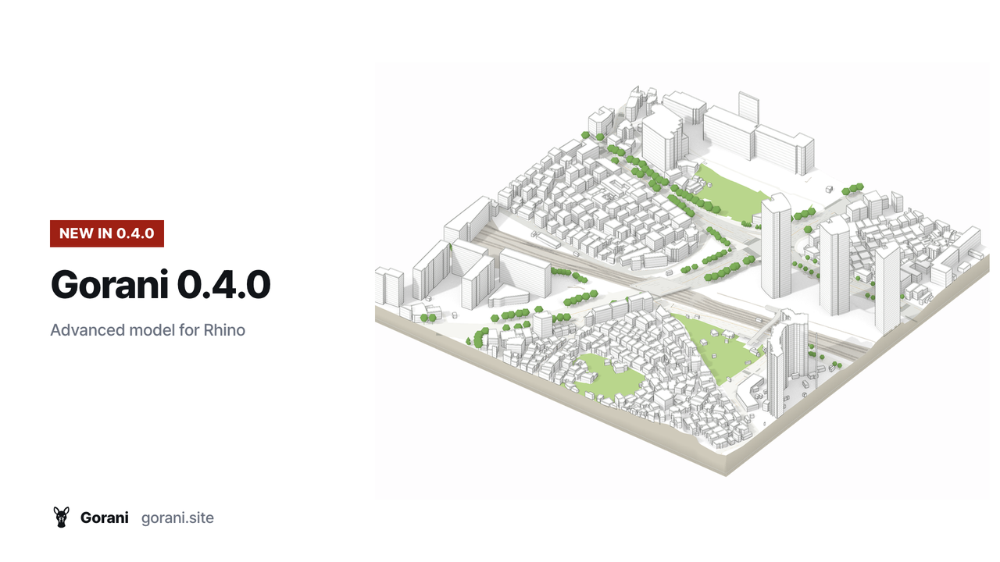

  

<h1 align="center">Gorani</h1>

  <b>지도에서 대상지를 고르면 주변 도시를 3D 컨텍스트 모델·베이스맵·현황도로 만들어 줍니다.</b> 
  Rhino·SketchUp·Blender·Archicad용 무료 플러그인입니다.

  <a href="https://gorani.site/">웹사이트</a> ·
  <a href="#설치">설치</a> ·
  <a href="https://github.com/969flash/gorani-plugin/issues">문의·버그</a> ·
  <a href="https://github.com/sponsors/969flash">후원</a> ·
  <a href="README.md">English</a>

  

필지를 고르거나, 구역을 그리거나, 위치만 찍은 뒤 범위를 정하고 버튼 하나를 누릅니다. 건물·도로·지형·수계·녹지·철도가 레이어별로 열린 문서에 들어오고, 쓴 데이터의 출처와 기준일이 결과에 함께 적힙니다.

## 결과물

- **3D**: 높이가 있는 건물 매스, 도로면, 지형, 수계, 녹지, 철도, 교량(레이어별)
- **고급 모델**(0.4.0): 파라펫, 층 구분선, 노면 표시, 가로수, 철도 선로, 옹벽. 구글 계정으로 로그인하면 무료이고, 로그인 없이 3번 써 볼 수 있습니다. Blender판은 로그인 없이 전부 열려 있습니다.
- **2D**(3D 뒤에 추가): 일러스트레이터 베이스맵(.ai), 현황도·분석도(.svg, .ai), DWG(Rhino 8·9), 조서(CSV)
- **데이터**: 국내는 전국 필지·컨텍스트 팩, 해외는 공식 건물 데이터가 있는 나라(일본·네덜란드·프랑스·스위스·미국)는 그것, 그 밖은 OpenStreetMap

## 설치

| 프로그램 | 버전 | 받는 곳 |
|---|---|---|
| Rhino | 7, 8, 9 | 명령창 `PackageManager` → **Gorani** 검색 → 설치 → Rhino 다시 켜기. [food4Rhino](https://www.food4rhino.com/en/app/gorani) |
| SketchUp | 2022 이상 | [Releases](https://github.com/969flash/gorani-plugin/releases/latest)의 `.rbz` → 확장 프로그램 관리자에서 설치 |
| Blender | 4.2 이상 | 환경 설정 > Get Extensions에서 **Gorani** 검색. [Blender Extensions](https://extensions.blender.org/add-ons/gorani/) |
| Archicad | 27~30 | [Releases](https://github.com/969flash/gorani-plugin/releases/latest)에서 버전·OS에 맞는 zip. [설치 안내](docs/archicad.md) |
| AutoCAD | 2D만 | [Releases](https://github.com/969flash/gorani-plugin/releases/latest)의 `Gorani-autocad-*.zip`(0.3.6). 2D DXF 도면 |

사용법은 [docs/install.md](docs/install.md), 데이터 출처·라이선스는 [docs/data_sources.md](docs/data_sources.md)에 있습니다. 데이터는 정보 제공용이며 법적 효력이 없습니다.

## 후원

Gorani는 후원으로 운영합니다. 후원을 통해 새로운 기능이 도입됩니다. [GitHub에서 후원하기](https://github.com/sponsors/969flash)

## 라이선스

Gorani는 [GNU 일반 공중 사용 허가서 3판 이상](LICENSE)(GPL-3.0-or-later)을 따르는 자유 소프트웨어입니다. 누구나 쓰고, 나누고, 고칠 수 있습니다. 고친 판을 나눌 때는 그 소스도 같은 라이선스로 공개합니다.

다른 사람이 만든 코드는 원래 라이선스를 따릅니다: `scripts/vendor/`의 Leaflet(BSD-2-Clause)·Pretendard(OFL-1.1), `archicad/`의 Tapir(MIT). SketchUp·Rhino 7·Archicad 패키지에 함께 든 Python·NumPy·Shapely도 각자의 라이선스를 따릅니다. 목록은 [THIRD_PARTY_NOTICES.md](THIRD_PARTY_NOTICES.md)에 있습니다. 데이터 라이선스는 따로입니다: [docs/data_sources.md](docs/data_sources.md)를 보세요.
