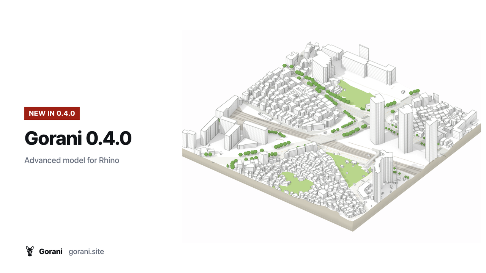
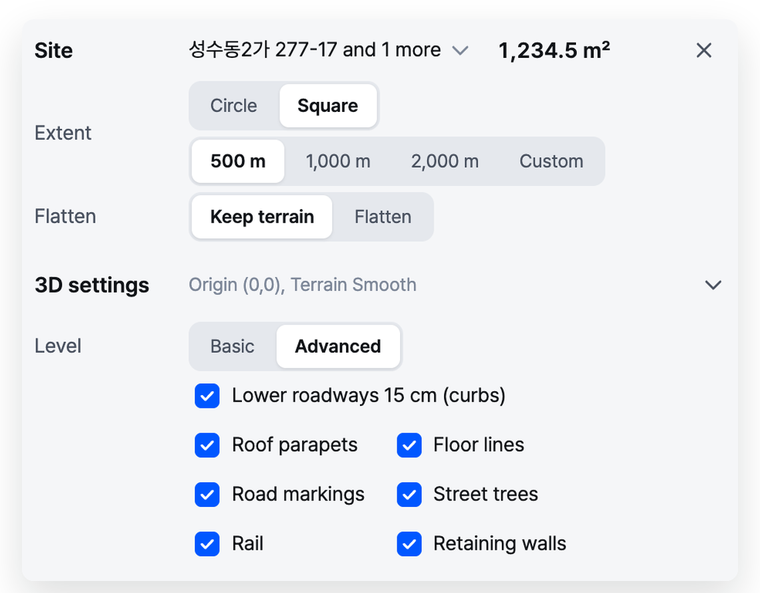

<p align="center">
  
</p>

<h1 align="center">Gorani</h1>

<p align="center">
  <b>Pick a site on the map. Get the city around it as a 3D context model, a basemap and analysis maps.</b><br>
  Free plugin for Rhino, SketchUp, Blender and Archicad.
</p>

<p align="center">
  <a href="https://github.com/969flash/gorani-plugin/releases/latest"></a>
  <a href="https://www.food4rhino.com/en/app/gorani"></a>
  <a href="https://extensions.blender.org/add-ons/gorani/"></a>
  <a href="https://gorani.site/en/"></a>
  <a href="LICENSE"></a>
  <a href="https://github.com/sponsors/969flash"></a>
</p>

<p align="center">
  <a href="https://gorani.site/en/">Website</a> ·
  <a href="#install">Install</a> ·
  <a href="#data-sources-and-licenses">Data</a> ·
  <a href="https://github.com/969flash/gorani-plugin/issues">Issues</a> ·
  <a href="https://github.com/sponsors/969flash">Sponsor</a> ·
  <a href="README.ko.md">한국어</a>
</p>



Gorani is a site context tool for architects, urban designers and students. Choose a site (pick parcels, draw an area, or drop a point), set the extent, and press one button. Buildings, roads, terrain, water, green space and rail come into your open document on their own layers, with the source and date of every dataset written into the output.

## Features

- **3D context model**: building masses with heights, road surfaces, terrain, water, green space, rail and bridges, one layer per element.
- **Advanced model** (new in 0.4.0): roof parapets, floor lines, road markings, street trees, rail tracks and retaining walls. Free with a Google sign-in; you can try it 3 times without signing in. Blender has no sign-in and all details are open.
- **2D outputs**, made after the 3D model: a layered basemap for Illustrator (`.ai`), analysis maps (`.svg`, `.ai`), DWG in Rhino 8 and 9, and parcel and building tables (CSV).
- **Works anywhere**: Korea uses national parcel and context data packs; elsewhere Gorani uses official building data where a country publishes it, and OpenStreetMap otherwise.
- **Real or local coordinates**: keep real-world coordinates, or move the model to a local origin near the site.
- **Five languages**: English, Korean, Spanish, Japanese and Simplified Chinese.

<p align="center">
  
</p>

## Install

| Host | Version | How to get it |
|---|---|---|
| Rhino | 7, 8, 9 (Windows, Mac) | Type `PackageManager`, search **Gorani**, install, restart Rhino. Also on [food4Rhino](https://www.food4rhino.com/en/app/gorani). |
| SketchUp | 2022+ (Windows, Mac) | Download `bsh_gorani-<version>.rbz` from [Releases](https://github.com/969flash/gorani-plugin/releases/latest), then *Extensions > Extension Manager > Install Extension*. |
| Blender | 4.2+ | *Preferences > Get Extensions*, search **Gorani**, or the [Blender Extensions page](https://extensions.blender.org/add-ons/gorani/). |
| Archicad | 27, 28, 29, 30 (Windows, Mac) | Download the zip for your version and OS from [Releases](https://github.com/969flash/gorani-plugin/releases/latest). Steps: [docs/archicad.md](docs/archicad.md). |
| AutoCAD | 2D only | `Gorani-autocad-*.zip` (0.3.6) in [Releases](https://github.com/969flash/gorani-plugin/releases/latest). Makes a 2D DXF drawing, no 3D. |

No separate Python or pip install. Rhino 8/9 and Blender use their built-in Python; SketchUp, Rhino 7 and Archicad packages bundle their own.

## Quick start

1. Run `Gorani` (Rhino command), or open Gorani from the Extensions / sidebar / menu in other hosts.
2. Pick the site on the map and choose the extent (500 m to 2,000 m, or custom).
3. In Korea, download the data pack for the area once (button on the map). Elsewhere, data comes online at build time.
4. Press **Make 3D model**. When it is done, add 2D outputs if you need them.

Results go to `~/Gorani/result/<site>_<date>/` (you can change the folder in the panel menu).

## Data sources and licenses

Gorani prints the source, license and reference date of the data it used on every drawing and in the 3D file. Data is for reference only and has no legal effect.

| Where | Data | License |
|---|---|---|
| Korea | Parcels and land use plans (MOLIT Land Characteristics, Land Use Plan) | No restriction on use (data.go.kr) |
| Korea | Seoul urban planning (UPIS), Seoul road markings and street trees | KOGL Type 1 |
| Korea | Buildings, roads, water, contours (NGII 1:5,000 digital topographic map, GIS building data) | KOGL Type 1 / CC BY. Served from a server in Korea: the Spatial Data Act restricts taking this survey data abroad |
| Japan | MLIT PLATEAU 3D city models | PLATEAU terms (CC BY 4.0 compatible) |
| Japan | GSI elevation tiles | GSI terms (attribution) |
| Netherlands | Kadaster 3D Basisvoorziening | CC BY 4.0 |
| France | IGN BD TOPO® | Licence Ouverte 2.0 |
| Switzerland | swisstopo swissBUILDINGS3D | OGD terms (free use with attribution) |
| USA | Overture Maps buildings | ODbL 1.0 |
| Anywhere else | OpenStreetMap (Overpass, OpenFreeMap fallback) | ODbL 1.0, © OpenStreetMap contributors |
| Terrain abroad | Mapterhorn, AWS Terrain Tiles | Open data, per source; credited on the drawing |

New countries are added as data packs without a plugin update. Details: [docs/data_sources.md](docs/data_sources.md) (Korean).

## Docs

- [Install and use](docs/install.md) (Korean)
- [Outputs](docs/deliverables.md) · [Data sources](docs/data_sources.md) · [Code map](docs/code_map.md) (Korean)
- [Archicad](docs/archicad.md)

## Contributing

Bug reports and requests are welcome in [Issues](https://github.com/969flash/gorani-plugin/issues). Please include the host and version, the site (address or coordinates) and `log.txt` from the result folder.

Tests run without Rhino:

```sh
python3 -m unittest discover tests
```

See [CONTRIBUTING.md](CONTRIBUTING.md). Report security problems privately: [SECURITY.md](SECURITY.md). Changes per release: [CHANGELOG.md](CHANGELOG.md).

## Support

Gorani runs on sponsorships. Sponsorships bring new features. [Sponsor Gorani on GitHub](https://github.com/sponsors/969flash).

## License

Gorani is free software under the [GNU General Public License v3.0 or later](LICENSE) (GPL-3.0-or-later). You may use, share and change it; if you share a changed version, share its source under the same license.

Third-party code keeps its own license: Leaflet (BSD-2-Clause) and Pretendard (OFL-1.1) in `scripts/vendor/`, and Tapir (MIT) in `archicad/`. The SketchUp, Rhino 7 and Archicad packages also bundle Python, NumPy and Shapely under their own licenses. See [THIRD_PARTY_NOTICES.md](THIRD_PARTY_NOTICES.md). Data has separate licenses: see [Data sources and licenses](#data-sources-and-licenses).

Published by **Gorani** · [gorani.site](https://gorani.site/en/)
